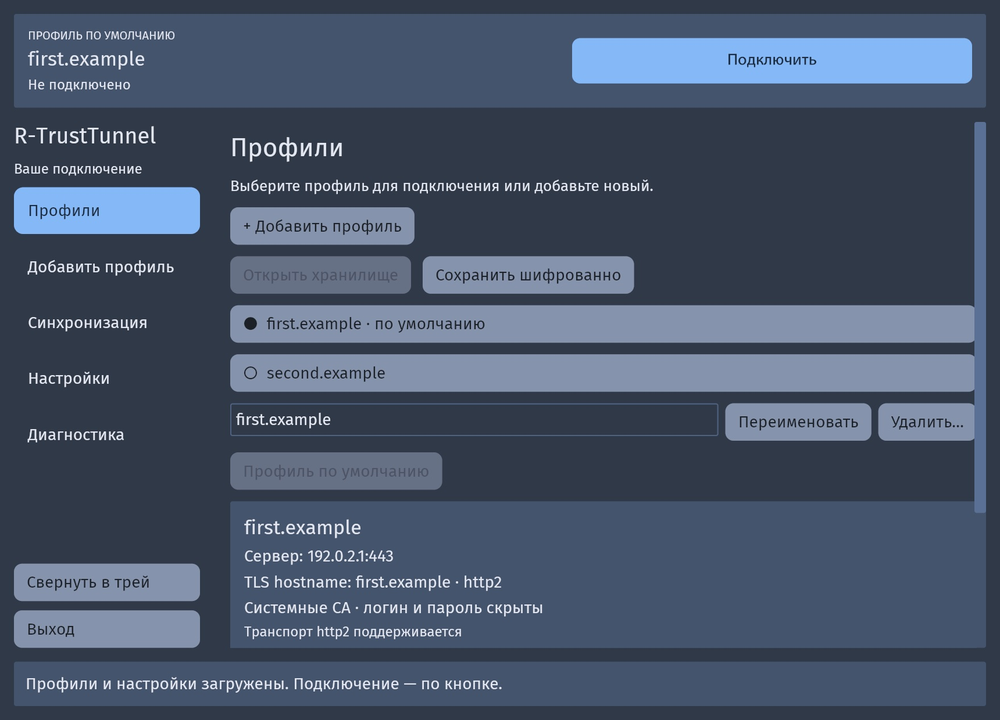
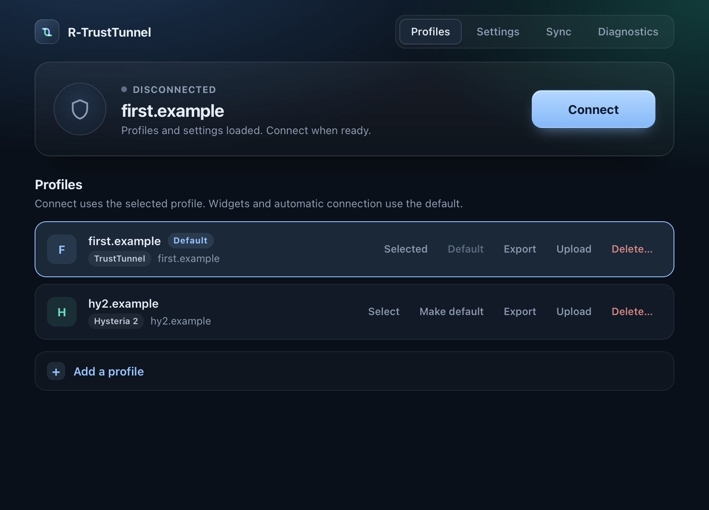

# R-TrustTunnel

[English](Readme.md) · [Русский](readme_ru.md)

R-TrustTunnel is a native VPN client written in Rust for **TrustTunnel**, **Hysteria 2** and **AmneziaWG 3**. The repository contains Windows/Linux desktop clients, macOS desktop/system-VPN packaging, Android VpnService, an iOS Network Extension preview, shared Rust transport/profile/storage/mobile crates and privileged desktop tunnel services.

The client implements its own transport and does **not** wrap the official TrustTunnel or Hysteria CLI.

> **Project status: development preview, October 21, 2026.**
>
> The source workspace is **0.6.2**, update sequence 12. [v0.6.2](https://github.com/onixus/Rust-trustvpn/releases/tag/v0.6.2) (October 21, `4123160`) is the latest release, with packages for Windows, macOS, Linux and Android; changes are listed [below](#whats-new-in-062) and in plain language in [docs/releases/v0.6.2.md](docs/releases/v0.6.2.md). Publication does not establish installed-package acceptance or production readiness. See [current implementation and open gates](docs/project-status.md). iOS archives are only in [v0.5.0](https://github.com/onixus/Rust-trustvpn/releases/tag/v0.5.0).

## Download

| Platform | Latest published artifact set | Notes |
| --- | --- | --- |
| Windows x64 | `R-TrustTunnel-Windows-x64-Setup.exe` from [v0.6.2](https://github.com/onixus/Rust-trustvpn/releases/tag/v0.6.2) | Not Authenticode signed. Update/rollback of this exact package has not been accepted. |
| macOS Apple Silicon | `R-TrustTunnel-macOS-arm64-UI-Choices.dmg` from [v0.6.2](https://github.com/onixus/Rust-trustvpn/releases/tag/v0.6.2) (Native, WebView and Both PKGs in one DMG) | Install exactly one PKG. Ad-hoc sealed, not Developer ID signed or notarized. System-VPN acceptance is incomplete and automatic-update promotion is withheld ([release assets](docs/releases/README.md)). |
| Android 10+, arm64 / x86_64 | `R-TrustTunnel-Android.apk` from [v0.6.2](https://github.com/onixus/Rust-trustvpn/releases/tag/v0.6.2) | 0.6.2 / 60202; release key introduced in 0.6.0. 0.6.0, 0.6.1 and 0.6.2-beta.1 update in place; 0.5.x and older must be reinstalled, which removes local profiles. |
| Linux x86_64, Wayland | Native / WebView / Both Flatpaks and `rtrust-host-0.6.2-12` from [v0.6.2](https://github.com/onixus/Rust-trustvpn/releases/tag/v0.6.2) | System VPN needs the separate host package. |
| iOS arm64 / Simulator | Archives from [v0.5.0](https://github.com/onixus/Rust-trustvpn/releases/tag/v0.5.0) | No iOS assets in v0.6.x. Device archive requires Apple signing and is not an installable IPA. |

v0.6.2 includes SHA256SUMS and its source identity. Their presence is not independent signature, provenance or update-channel verification. Release scope: [v0.6.2](docs/releases/v0.6.2.md), [v0.6.1](docs/releases/v0.6.1.md).

## What's new in 0.6.2

Since v0.6.1, in all v0.6.2 desktop and Android packages:

- **macOS wake reconnect** ([#100](https://github.com/onixus/Rust-trustvpn/pull/100)). After sleep the reconnected tunnel carries traffic again instead of stalling until a manual Stop/Start.
- **Quiet stalled flows** ([#103](https://github.com/onixus/Rust-trustvpn/pull/103), [#104](https://github.com/onixus/Rust-trustvpn/pull/104)). A few live connections no longer hide hundreds of stalled ones; the session is reported degraded and reconnects, in Native SOCKS mode too, without a direct path.
- **Probes only while viewed** ([#102](https://github.com/onixus/Rust-trustvpn/pull/102)). Desktop system probes run only while a UI window shows the session (control IPC v7).

- **macOS guard proof** ([#96](https://github.com/onixus/Rust-trustvpn/pull/96)). PF drops output silently, so the macOS service proves its kill switch with a read-only BPF tap and a per-run control frame instead of an errno. On the installed package the guard and DNS rows turn green in whole-computer mode, and a broken guard turns them failed.
- **macOS lifecycle** ([#80](https://github.com/onixus/Rust-trustvpn/pull/80), [#94](https://github.com/onixus/Rust-trustvpn/pull/94), [#95](https://github.com/onixus/Rust-trustvpn/pull/95)). Stop answers Status and finishes in under half a second on the lab Mac; Stop and reconnect timings go to `events.log`; PF states left by other VPNs (Cisco AnyConnect) are flushed on connect instead of refusing it.
- **Android sleep recovery** ([#92](https://github.com/onixus/Rust-trustvpn/pull/92)). The reconnect budget is restored after a stable session, timers count real time across sleep, and wake-up checks the transport.

- **Desktop service probes** ([#84](https://github.com/onixus/Rust-trustvpn/pull/84), [#91](https://github.com/onixus/Rust-trustvpn/pull/91)). In whole-computer mode the Linux, macOS and Windows services check their own guard (kill switch) and tunnel DNS read-only every 15 seconds while connected and recently viewed by a UI. They also confirm the transport by a DNS reply through the tunnel. Results expire after 30 seconds, so a green status falls back to blue without fresh evidence. In selected-networks mode DNS and guard are reported as unsupported and the status stays blue. See [VPN observations](docs/vpn-observations.md#service-system-probes-issue-81).
- **Dead-session detection** ([#69](https://github.com/onixus/Rust-trustvpn/pull/69)). A session that carries no traffic fails its health check and reconnects through the guarded path; see [HTTP/3](docs/http3.md#dead-session-detection). Installed macOS sleep/wake passed on two Macs at `da92864` ([#99 evidence](https://github.com/onixus/Rust-trustvpn/issues/99#issuecomment-6291062141)); roam, installed SOCKS wake and exact release-package acceptance remain open.
- **UI variant 3** for Android ([#73](https://github.com/onixus/Rust-trustvpn/pull/73), with route/DNS/HTTPS checks through the VPN network) and for Native, WebView and iOS ([#74](https://github.com/onixus/Rust-trustvpn/pull/74)).
- **[Linux terminal client](docs/tui.md)** `rtrust-tui` over the shared desktop controller ([#72](https://github.com/onixus/Rust-trustvpn/pull/72)).
- **Android network changes** ([#86](https://github.com/onixus/Rust-trustvpn/pull/86), [#89](https://github.com/onixus/Rust-trustvpn/pull/89)). An IPv6 address or route appearing after Wi-Fi returns no longer rebuilds the session and drops open connections. A rebuild still happens when the interface, MTU, a needed address or a route really changes.
- **Linux lab acceptance** with packet-level leak counters for failover and Always-on recovery ([#87](https://github.com/onixus/Rust-trustvpn/pull/87)) and runtime route-explain checks against the dataplane ([#88](https://github.com/onixus/Rust-trustvpn/pull/88)). These run in containers, not on installed packages.

## What is new in 0.6.0 and 0.6.1

Compared with v0.5.0-rebuild.9:

- **Honest connection status.** Typed observations (passed, failed, configured, unknown, stale, unsupported) replace "Connected means working". Since 0.6.1 the status lists only checks that produced a result, for example "Transport: running". See [VPN observations](docs/vpn-observations.md).
- **Desktop diagnostics.** System-path checks through the active tunnel run on connect and every 30 seconds, with typed verdicts, an endpoint probe and follow-up actions. Offline route explanations use the dataplane's own evaluator. See [system diagnostics](docs/system-diagnostics.md) and [route explain](docs/route-explain.md).
- **Guarded recovery.** Opt-in switching to up to three user-approved backup profiles; the guard stays up during recovery. Always-on recovery through backup candidates is Linux and Windows only. See [failover](docs/failover.md) and [recovery](docs/recovery.md).
- **Desktop control IPC v6.** GUI and service must come from the same package.
- **macOS.** VPN restore after sleep, and the service keeps supervising the VPN when the GUI disconnects.
- **Android.** Compact widget and Quick Settings tile. The VPN follows the network Android prefers after a Wi-Fi/mobile handoff. Optional "VPN data usage" metering setting. New release signing key.
- **Managed profiles.** They keep provenance, assigned routing and offline receipts. Portal profile-limit replies are explained on desktop, Android and iOS. See [managed devices](docs/managed-devices.md).

Route groups are desktop-only. Android/iOS use the routing policy embedded in the profile.

## Features

### Client and profile management

- Native Rust/iced desktop UI, an optional Tauri WebView frontend and, on Linux, a terminal client in main.
- Native Android application using VpnService plus the shared Rust core.
- Import of endpoint TOML, full client TOML, R-TrustTunnel JSON, Hysteria YAML/JSON, AmneziaWG `awg-quick` files, tt://, hy2:// and hysteria2://.
- Preview and validation before profile replacement.
- Automatic encrypted profile persistence. Desktop stores the encryption key in the OS credential store; Android uses Android Keystore. There is no plaintext fallback.
- System tray, startup options, autoconnect preference, diagnostics and explicit recovery flows.
- Server-side device enrollment and scoped profile synchronization through the TrustTunnel portal extension.

### TrustTunnel

- Native Rust HTTP/2 and HTTP/3 transports for system VPN and SOCKS5; the profile selects the transport, with no silent fallback, see [HTTP/3](docs/http3.md).
- IPv4/IPv6 TCP and UDP handling, DNS, ICMP where supported by the platform dataplane, bounded fragmentation handling, reconnect and fail-closed protection.

### Hysteria 2

The shared engine automatically selects Hysteria 2 for hy2://, hysteria2:// and supported Hysteria YAML/JSON profiles.

Current main supports:

- QUIC + HTTP/3 authentication;
- multiplexed TCP and UDP datagrams;
- Salamander and Gecko obfuscation;
- server port hopping and hop intervals;
- bandwidth negotiation and Brutal upload control;
- BBR/Reno selection plus the default congestion controller;
- QUIC receive windows, idle timeout, keepalive and fixed-MTU behaviour;
- TLS SNI and pinSHA256 validation in addition to normal CA/hostname verification;
- embedded custom CA and mutual-TLS certificate/key in R-TrustTunnel JSON.

Unsupported or intentionally rejected options include insecure TLS, ECH, Hysteria Realms, Chrome QUIC fingerprint parroting, mimic, fastOpen/lazy and non-standard BBR profiles. Hysteria 2 has no ICMP relay.

See [Hysteria 2 support and limits](docs/hysteria2.md).

AmneziaWG 3 `awg-quick` configurations select an in-process WireGuard transport with the AmneziaWG obfuscation layer (junk and signature packets, prefixes, type ranges, header protection, padding). It is verified against the official `amneziawg-go` 3.1 on loopback only; see [supported options and limits](docs/amneziawg.md).

## Platform status

| Platform | Current state | Important remaining work |
| --- | --- | --- |
| Windows x64 | Native UI, Wintun/SCM service and WFP guard. Production full-tunnel checks passed for TrustTunnel and Hysteria 2. A real 30-minute S3 sleep/wake Hysteria session passed, including reconnect and traffic checks; Always-on also remained blocked until automatic recovery. | Cold-boot coverage, broader sleep/network combinations, refreshed public installer delivery and signing. |
| Linux x86_64 / ARM64 | Wayland-only desktop, TUN host service, nftables and systemd-resolved. Native/WebView/Both packaging, physical KDE/Wayland smoke, signed Flatpak flow, TrustTunnel/Hysteria full-tunnel and network-handoff coverage exist. | More physical reboot/sleep coverage and final installer polish across distributions. |
| macOS Apple Silicon | Native/WebView/Both preview, root LaunchDaemon and utun system tunnel. TrustTunnel live IPv4/IPv6 TCP/UDP/ICMP, DNS, reconnect and service-crash recovery passed. | Boot Always-on, sleep/network handoff, clean install on another Mac, signed automatic update/rollback, Developer ID/notarization. Installed macOS Hysteria full-tunnel acceptance is still incomplete. |
| Android arm64 / x86_64 | Native VpnService, encrypted vault, file/text/QR import, app selection, portal sync, Always-on/lockdown and TrustTunnel/Hysteria support. Physical POCO and Huawei testing covers real traffic and recovery paths; POCO passed 30 minutes of forced deep Doze. | More OEMs such as Pixel/Samsung, reboot-before-first-unlock and overnight/long soak. MIUI force-stop can leave lockdown active without automatically restarting the VPN service. While the VPN process is dead, lockdown is incomplete: on an Android 16 emulator the system resolver sent other apps' DNS directly and Google Play services traffic went direct. A profile imported without the portal resolves its endpoint before the blocking TUN exists. |

Desktop Native/WebView/Both details are in [UI choices](docs/ui-choices.md). Linux is Wayland-only.

## Screenshots

Desktop UI of the published 0.6.1 with synthetic profiles. Main has since moved to UI variant 3 (#74), which is not captured yet:

| Native | WebView |
| --- | --- |
|  |  |

More screens (import, settings, sync, diagnostics) and how they were made are in the [screenshot gallery](docs/screenshots/README.md). Android blocks screenshots with `FLAG_SECURE`.

## Build

The workspace requires **Rust 1.89+**. Current CI uses Rust 1.98.1.

Clone and run the native UI:

    git clone https://github.com/onixus/Rust-trustvpn.git
    cd Rust-trustvpn
    cargo run -p rtrust-native --locked

Build the main desktop/service binaries:

    cargo build --release -p rtrust-native -p rtrust-tun -p rtrust-inspect -p rtrust-tui --locked

Run the standard Rust checks:

    cargo fmt --all --check
    cargo test --workspace --locked
    cargo clippy --workspace --all-targets --locked -- -D warnings

Platform packaging entry points:

- **Windows:** python ci/package_windows.py
- **macOS:** python3 scripts/package-macos-system.py
- **Android:** python3 scripts/build-android.py
- **Linux:** python3 scripts/package-flatpak.py

Platform-specific prerequisites and acceptance limits are documented in:

- [Windows service](docs/windows-service.md)
- [Linux service](docs/linux-service.md)
- [Terminal client (TUI)](docs/tui.md)
- [macOS system VPN](docs/macos-system.md)
- [Android](docs/android.md)
- [Jenkins / CI](docs/jenkins.md)

Run the GUI as a normal desktop user. System VPN on desktop requires the privileged host service installed separately. The Flatpak itself is intentionally unprivileged.

## Using the client

### Desktop

1. Import a profile file (TrustTunnel TOML, Hysteria YAML, AmneziaWG `.conf`, JSON) or open/paste a tt://, hy2:// or hysteria2:// link.
2. Review the parsed profile and add or replace it.
3. Select the profile to connect and the connection mode.
4. For system VPN, install the matching platform service first.
5. Connect from the main screen. Closing the native window normally keeps the application available in the tray.
6. Profile changes are written automatically to the encrypted vault.

SOCKS5 mode listens on 127.0.0.1:1080 by default:

    curl --socks5-hostname 127.0.0.1:1080 https://example.com

SOCKS5 mode does not change system routes or DNS. BIND, SOCKS UDP domain addressing and SOCKS UDP fragmentation are not supported.

In system VPN split mode, the configured DNS server becomes the system resolver when the selected networks route it through the tunnel (for example, everything except the LAN). As in full mode, LAN-only names such as `router.lan` then stop resolving. Otherwise DNS is left unchanged. On Windows, port 53 is then allowed only through the tunnel and loopback. If the system cannot accept a resolver (no systemd-resolved on Linux; the macOS DNS preflight fails), DNS is skipped instead of failing the connection.

See [desktop lifecycle](docs/desktop-lifecycle.md) and [Always-on](docs/always-on.md).

### Android

1. Install the APK and import a file, pasted profile/link or QR code.
2. Select a profile and tap Connect. Widgets and automatic connection use the separately assigned default profile.
3. Accept Android VPN consent.
4. Optionally configure an app allowlist in VPN apps.
5. For fail-closed behaviour after process death, enable Android **Always-on VPN** and **Block connections without VPN**.
6. Server profiles can be enrolled and synchronized through the portal integration.

The source tree currently declares Android minSdk 29, targetSdk 36, versionCode 60202 and versionName 0.6.2 ([v0.6.2](docs/releases/v0.6.2.md)), signed with the release key introduced in v0.6.0 (it does not update APKs from v0.5.0 or earlier).

See [Android documentation](docs/android.md) and [profile exchange](docs/portal.md).

## Validation highlights

Current evidence includes:

- official Hysteria 2.12.3 interop fixtures for TCP, UDP, authentication/TLS rejection, Salamander, Gecko + mTLS, port hopping and Brutal behaviour;
- Windows production TrustTunnel and Hysteria 2 full-tunnel tests with WFP fail-closed behaviour and exact route recovery;
- Windows 30-minute S3 sleep/wake checks, including Always-on recovery;
- physical Android TrustTunnel/Hysteria testing on POCO X3 and Huawei devices;
- 30-minute forced deep Doze on POCO with tunnel egress retained;
- macOS live TrustTunnel IPv4/IPv6, DNS, reconnect and crash-recovery acceptance;
- Linux system-service, Wayland, Flatpak and network-handoff coverage;
- Linux lab (containers): packet-level failover, Always-on recovery and route-explain lanes in main.

Passing one platform or protocol test does not imply every release package has been rebuilt with the newest main-branch changes. See the linked platform documents for exact evidence and open items.

## Repository layout

| Path | Purpose |
| --- | --- |
| apps/native | Native desktop client |
| apps/webview | Optional Tauri WebView desktop frontend |
| apps/tun | Desktop TUN/Wintun/utun dataplane and services |
| apps/android | Android VpnService application and JNI/Rust integration |
| apps/ios | iOS Swift/Network Extension preview and shared Rust core |
| apps/macos | macOS application/system integration |
| apps/tui | Linux terminal client |
| apps/inspect, apps/codec | Diagnostics and profile tooling |
| crates | Shared profile, transport, storage, control, desktop, mobile, portal-client and update logic |
| deploy | Client-side service/update deployment assets |
| packaging, scripts | Packaging and interoperability helpers |
| ci, Jenkinsfile* | Build, security and runtime validation |
| vendor/h2, vendor/h3 | Patched HTTP/2 and HTTP/3 dependencies |
| docs | Architecture, platform status, releases and acceptance evidence |

The server implementation, administration UI and server deployment belong to [onixus/tunnel](https://github.com/onixus/tunnel). This repository contains VPN clients, client-side portal integration and the [portal API contract](docs/profile-api.md).

## Documentation

Overview:

- [Project status and open issues](docs/project-status.md) · [Implementation status](docs/implementation.md) · [Architecture](docs/architecture.md) · [Delivery and acceptance](docs/delivery.md) · [Technical debt](docs/technical-debt.md)
- [Release records](docs/releases/) · [Package acceptance](docs/package-acceptance.md) · [Secure updates](docs/secure-updates.md) · [Evidence](docs/evidence.md)

Protocols: [HTTP/3](docs/http3.md) · [Hysteria 2](docs/hysteria2.md) · [AmneziaWG](docs/amneziawg.md)

Connection behaviour: [VPN observations](docs/vpn-observations.md) · [System diagnostics](docs/system-diagnostics.md) · [Route explain](docs/route-explain.md) · [Routing policy](docs/routing-policy.md) · [Failover](docs/failover.md) · [Recovery](docs/recovery.md) · [Always-on](docs/always-on.md) · [Desktop lifecycle](docs/desktop-lifecycle.md)

Platforms:

- Desktop: [Desktop apps](docs/desktop-apps.md) · [UI choices](docs/ui-choices.md) · [Terminal client](docs/tui.md) · [Windows service](docs/windows-service.md) · [macOS system VPN](docs/macos-system.md) · [Linux service](docs/linux-service.md) · [Linux full tunnel](docs/linux-full-tunnel.md)
- Mobile: [Android](docs/android.md) · [iOS](docs/ios.md) · [Mobile flow observations](docs/mobile-flow-observations.md)

Portal and managed profiles: [Profile exchange](docs/portal.md) · [Profile API](docs/profile-api.md) · [Managed devices](docs/managed-devices.md) · [Access scope validation](docs/access-scope-validation.md)

CI and labs: [Jenkins](docs/jenkins.md) · [Linux lab](docs/linux-lab.md) · [Linux acceptance](docs/linux-acceptance.md) · [Android on macOS](docs/android-macos.md) · [macOS sleep recovery](docs/macos-sleep-recovery-validation.md)

Some historical documents describe older milestones. When they conflict, prefer the current platform-specific document and the newest release evidence.

## License

[Apache License 2.0](LICENSE). Vendored dependencies retain their own licenses.
