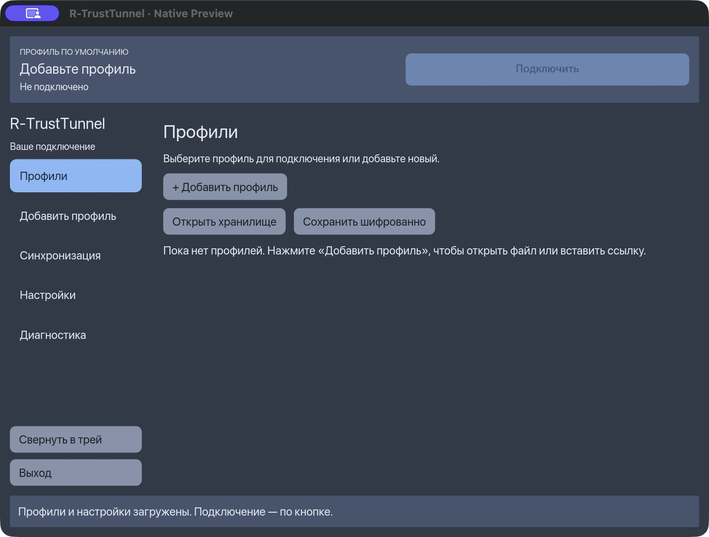
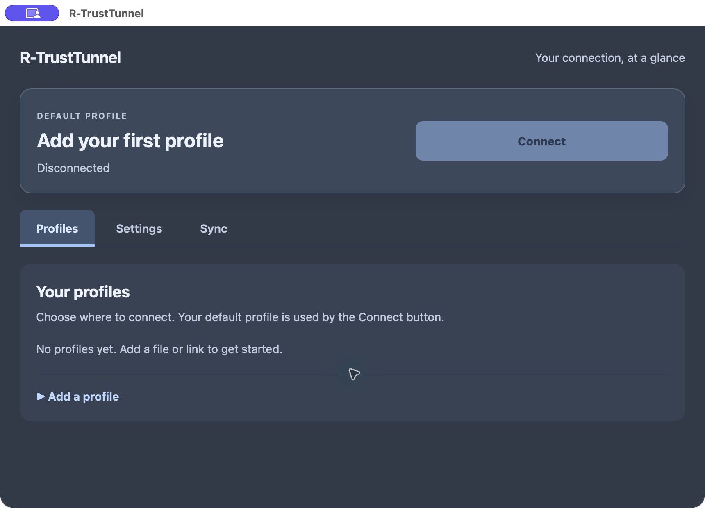

# R-TrustTunnel

[English](Readme.md) · [Русский](readme_ru.md)

R-TrustTunnel is a native VPN client written in Rust for **TrustTunnel**, **Hysteria 2** and **AmneziaWG 3**. The repository contains Windows/Linux desktop clients, macOS desktop/system-VPN packaging, Android VpnService, an iOS Network Extension preview, shared Rust transport/profile/storage/mobile crates and privileged desktop tunnel services.

The client implements its own transport and does **not** wrap the official TrustTunnel or Hysteria CLI.

> **Project status: development preview, October 14, 2026.**
>
> The source workspace is **0.6.1**, update sequence 11. [v0.6.1](https://github.com/onixus/Rust-trustvpn/releases/tag/v0.6.1) was published on October 13 from `db8796a`. Current main also includes H3 data-plane health, Linux TUI and UI variant 3, merged after that tag; those changes are not in the published 0.6.1 packages. Publication does not establish installed-package acceptance or production readiness. See [current implementation and open gates](docs/project-status.md).

## Download

| Platform | Latest published artifact set | Notes |
| --- | --- | --- |
| Windows x64 | Installer from [v0.6.1](https://github.com/onixus/Rust-trustvpn/releases/tag/v0.6.1) | Artifact presence verified; Authenticode and exact-package update/rollback acceptance were not verified in this refresh. |
| macOS Apple Silicon | UI Choices, preview, bundled/system candidate DMG/PKG from v0.6.1 | Candidate naming remains; Developer ID/notarization and system-VPN acceptance are not established by publication. |
| Android 10+, arm64 / x86_64 | `R-TrustTunnel-Android.apk` from v0.6.1 | Source version 0.6.1-preview.1 / 60101; release key introduced in 0.6.0. Older 0.5.x installations require reinstall. Artifact certificate was not rechecked here. |
| Linux x86_64, Wayland | Native / WebView / Both Flatpaks from [v0.5.0-rebuild.9](https://github.com/onixus/Rust-trustvpn/releases/tag/v0.5.0-rebuild.9) | No Linux assets in v0.6.1. Historical signed install/update/rollback results apply to rebuild.9; system VPN needs the separate host package. |
| iOS arm64 / Simulator | Archives from [v0.5.0](https://github.com/onixus/Rust-trustvpn/releases/tag/v0.5.0) | No iOS assets in v0.6.1. Device archive requires Apple signing and is not an installable IPA. |

v0.6.1 includes SHA256SUMS and native source identity/manifest files. Their presence is not independent signature, provenance or update-channel verification. [Release scope](docs/releases/v0.6.1.md).

## Changes in main after v0.6.1

- H3 data-plane liveness and bounded degraded-session recovery ([#69](https://github.com/onixus/Rust-trustvpn/pull/69)); macOS sleep/roam acceptance remains open in #62.
- [Linux terminal client](docs/tui.md) over the shared desktop controller (#72).
- Android UI variant 3 with VPN-bound route/DNS/HTTPS checks (#73), and Native/WebView/iOS UI variant 3 (#74). Desktop/iOS still lack continuous route/DNS/guard/connectivity producers; running transport alone remains blue.

## What is new in v0.5.0 / rebuild.9

Compared with v0.4.0:

- iOS preview with profile import/export, QR import, portal sync, On Demand and a small VPN widget;
- Android VPN widget and shared mobile routing-policy updates;
- macOS glass appearance with a persistent Settings toggle and accessibility fallback;
- desktop IPv4 TUN include/exclude rules, LAN bypass and server-assigned route groups;
- HTTP requests on the mixed desktop proxy port;
- update sequence **9** for rebuilt desktop clients, fixing the old sequence-7 identity/rollback mismatch;
- repository boundary cleanup: the server implementation/deployment was removed from this repository and belongs to [onixus/tunnel](https://github.com/onixus/tunnel).

Route groups are desktop-only. Android/iOS continue to use profile-embedded routing policy and do not consume the separate group API.
## Features

### Client and profile management

- Native Rust/iced desktop UI and an optional Tauri WebView frontend.
- Native Android application using VpnService plus the shared Rust core.
- Import of endpoint TOML, full client TOML, R-TrustTunnel JSON, tt://, hy2:// and hysteria2://.
- Preview and validation before profile replacement.
- Automatic encrypted profile persistence. Desktop stores the encryption key in the OS credential store; Android uses Android Keystore. There is no plaintext fallback.
- System tray, startup options, autoconnect preference, diagnostics and explicit recovery flows.
- Server-side device enrollment and scoped profile synchronization through the TrustTunnel portal extension.

### TrustTunnel

- Native Rust HTTP/2 and HTTP/3 transports for system VPN and SOCKS5; the profile selects the transport, with no silent fallback, see [HTTP/3](docs/http3.md).
- IPv4/IPv6 TCP and UDP handling, DNS, ICMP where supported by the platform dataplane, bounded fragmentation handling, reconnect and fail-closed protection.
- HTTP/3 system VPN is in the current main, not in the v0.4.0 packages: those still run system tunnels over HTTP/2.

### Hysteria 2

The shared engine automatically selects Hysteria 2 for hy2://, hysteria2:// and supported Hysteria YAML/JSON profiles.

Current main supports:

- QUIC + HTTP/3 authentication;
- multiplexed TCP and UDP datagrams;
- Salamander and Gecko obfuscation;
- server port hopping and hop intervals;
- bandwidth negotiation and Brutal upload control;
- BBR/Reno selection plus the default congestion controller;
- QUIC receive windows, idle timeout, keepalive and fixed-MTU behaviour;
- TLS SNI and pinSHA256 validation in addition to normal CA/hostname verification;
- embedded custom CA and mutual-TLS certificate/key in R-TrustTunnel JSON.

Unsupported or intentionally rejected options include insecure TLS, ECH, Hysteria Realms, Chrome QUIC fingerprint parroting, mimic, fastOpen/lazy and non-standard BBR profiles. Hysteria 2 has no ICMP relay.

See [Hysteria 2 support and limits](docs/hysteria2.md).

AmneziaWG 3 `awg-quick` configurations select an in-process WireGuard transport with the AmneziaWG obfuscation layer (junk and signature packets, prefixes, type ranges, header protection, padding). It is verified against the official `amneziawg-go` 3.1 on loopback only; see [supported options and limits](docs/amneziawg.md).

## Platform status

| Platform | Current state | Important remaining work |
| --- | --- | --- |
| Windows x64 | Native UI, Wintun/SCM service and WFP guard. Production full-tunnel checks passed for TrustTunnel and Hysteria 2. A real 30-minute S3 sleep/wake Hysteria session passed, including reconnect and traffic checks; Always-on also remained blocked until automatic recovery. | Cold-boot coverage, broader sleep/network combinations, refreshed public installer delivery and signing. |
| Linux x86_64 / ARM64 | Wayland-only desktop, TUN host service, nftables and systemd-resolved. Native/WebView/Both packaging, physical KDE/Wayland smoke, signed Flatpak flow, TrustTunnel/Hysteria full-tunnel and network-handoff coverage exist. | More physical reboot/sleep coverage and final installer polish across distributions. |
| macOS Apple Silicon | Native/WebView/Both preview, root LaunchDaemon and utun system tunnel. TrustTunnel live IPv4/IPv6 TCP/UDP/ICMP, DNS, reconnect and service-crash recovery passed. | Boot Always-on, sleep/network handoff, clean install on another Mac, signed automatic update/rollback, Developer ID/notarization. Installed macOS Hysteria full-tunnel acceptance is still incomplete. |
| Android arm64 / x86_64 | Native VpnService, encrypted vault, file/text/QR import, app selection, portal sync, Always-on/lockdown and TrustTunnel/Hysteria support. Physical POCO and Huawei testing covers real traffic and recovery paths; POCO passed 30 minutes of forced deep Doze. | More OEMs such as Pixel/Samsung, reboot-before-first-unlock and overnight/long soak. MIUI force-stop can leave lockdown active without automatically restarting the VPN service. |

Desktop Native/WebView/Both details are in [UI choices](docs/ui-choices.md). Linux is Wayland-only.

## Screenshots

The current gallery contains real Native and WebView desktop captures from the v0.3.2 UI refresh:

| Native | WebView |
| --- | --- |
|  |  |

See [screenshots and connection settings](docs/screenshots/README.md).

The refreshed Android home screen is included in the v0.4.0 APK.

## Build

The workspace requires **Rust 1.89+**. Current CI uses Rust 1.98.1.

Clone and run the native UI:

    git clone https://github.com/onixus/Rust-trustvpn.git
    cd Rust-trustvpn
    cargo run -p rtrust-native --locked

Build the main desktop/service binaries:

    cargo build --release -p rtrust-native -p rtrust-tun -p rtrust-inspect -p rtrust-tui --locked

Run the standard Rust checks:

    cargo fmt --all --check
    cargo test --workspace --locked
    cargo clippy --workspace --all-targets --locked -- -D warnings

Platform packaging entry points:

- **Windows:** python ci/package_windows.py
- **macOS:** python3 scripts/package-macos-system.py
- **Android:** python3 scripts/build-android.py
- **Linux:** python3 scripts/package-flatpak.py

Platform-specific prerequisites and acceptance limits are documented in:

- [Windows service](docs/windows-service.md)
- [Linux service](docs/linux-service.md)
- [Terminal client (TUI)](docs/tui.md)
- [macOS system VPN](docs/macos-system.md)
- [Android](docs/android.md)
- [Jenkins / CI](docs/jenkins.md)

Run the GUI as a normal desktop user. System VPN on desktop requires the privileged host service installed separately. The Flatpak itself is intentionally unprivileged.

## Using the client

### Desktop

1. Import a profile file or open/paste a tt://, hy2:// or hysteria2:// link.
2. Review the parsed profile and add or replace it.
3. Select the profile to connect and the connection mode.
4. For system VPN, install the matching platform service first.
5. Connect from the main screen. Closing the native window normally keeps the application available in the tray.
6. Profile changes are written automatically to the encrypted vault.

SOCKS5 mode listens on 127.0.0.1:1080 by default:

    curl --socks5-hostname 127.0.0.1:1080 https://example.com

SOCKS5 mode does not change system routes or DNS. BIND, SOCKS UDP domain addressing and SOCKS UDP fragmentation are not supported.

In system VPN split mode, the configured DNS server becomes the system resolver when the selected networks route it through the tunnel (for example, everything except the LAN). As in full mode, LAN-only names such as `router.lan` then stop resolving. Otherwise DNS is left unchanged. On Windows, port 53 is then allowed only through the tunnel and loopback. If the system cannot accept a resolver (no systemd-resolved on Linux; the macOS DNS preflight fails), DNS is skipped instead of failing the connection.

See [desktop lifecycle](docs/desktop-lifecycle.md) and [Always-on](docs/always-on.md).

### Android

1. Install the APK and import a file, pasted profile/link or QR code.
2. Select a profile and tap Connect. Widgets and automatic connection use the separately assigned default profile.
3. Accept Android VPN consent.
4. Optionally configure an app allowlist in VPN apps.
5. For fail-closed behaviour after process death, enable Android **Always-on VPN** and **Block connections without VPN**.
6. Server profiles can be enrolled and synchronized through the portal integration.

The source tree currently declares Android minSdk 29, targetSdk 36, versionCode 60101 and versionName 0.6.1-preview.1 ([v0.6.1](docs/releases/v0.6.1.md)), signed with the release key introduced in v0.6.0 (it does not update APKs from v0.5.0 or earlier).

See [Android documentation](docs/android.md) and [profile exchange](docs/portal.md).

## Validation highlights

Current evidence includes:

- official Hysteria 2.12.3 interop fixtures for TCP, UDP, authentication/TLS rejection, Salamander, Gecko + mTLS, port hopping and Brutal behaviour;
- Windows production TrustTunnel and Hysteria 2 full-tunnel tests with WFP fail-closed behaviour and exact route recovery;
- Windows 30-minute S3 sleep/wake checks, including Always-on recovery;
- physical Android TrustTunnel/Hysteria testing on POCO X3 and Huawei devices;
- 30-minute forced deep Doze on POCO with tunnel egress retained;
- macOS live TrustTunnel IPv4/IPv6, DNS, reconnect and crash-recovery acceptance;
- Linux system-service, Wayland, Flatpak and network-handoff coverage.

Passing one platform or protocol test does not imply every release package has been rebuilt with the newest main-branch changes. See the linked platform documents for exact evidence and open items.

## Repository layout

| Path | Purpose |
| --- | --- |
| apps/native | Native desktop client |
| apps/webview | Optional Tauri WebView desktop frontend |
| apps/tun | Desktop TUN/Wintun/utun dataplane and services |
| apps/android | Android VpnService application and JNI/Rust integration |
| apps/ios | iOS Swift/Network Extension preview and shared Rust core |
| apps/macos | macOS application/system integration |
| apps/inspect, apps/codec | Diagnostics and profile tooling |
| crates | Shared profile, transport, storage, control, desktop, mobile, portal-client and update logic |
| deploy | Client-side service/update deployment assets |
| packaging, scripts | Packaging and interoperability helpers |
| ci, Jenkinsfile* | Build, security and runtime validation |
| vendor/h2 | Patched HTTP/2 dependency |
| docs | Architecture, platform status, releases and acceptance evidence |

The server implementation, administration UI and server deployment belong to [onixus/tunnel](https://github.com/onixus/tunnel). This repository contains VPN clients, client-side portal integration and the [portal API contract](docs/profile-api.md).

## Documentation

- [Implementation status](docs/implementation.md)
- [Architecture](docs/architecture.md)
- [Delivery and acceptance](docs/delivery.md)
- [Hysteria 2](docs/hysteria2.md)
- [Android](docs/android.md)
- [Desktop lifecycle](docs/desktop-lifecycle.md)
- [Secure updates](docs/secure-updates.md)
- [Profile exchange API](docs/profile-api.md)
- [Technical debt](docs/technical-debt.md)

Some historical documents describe older milestones. When they conflict, prefer the current platform-specific document and the newest release evidence.

## License

[Apache License 2.0](LICENSE). Vendored dependencies retain their own licenses.
