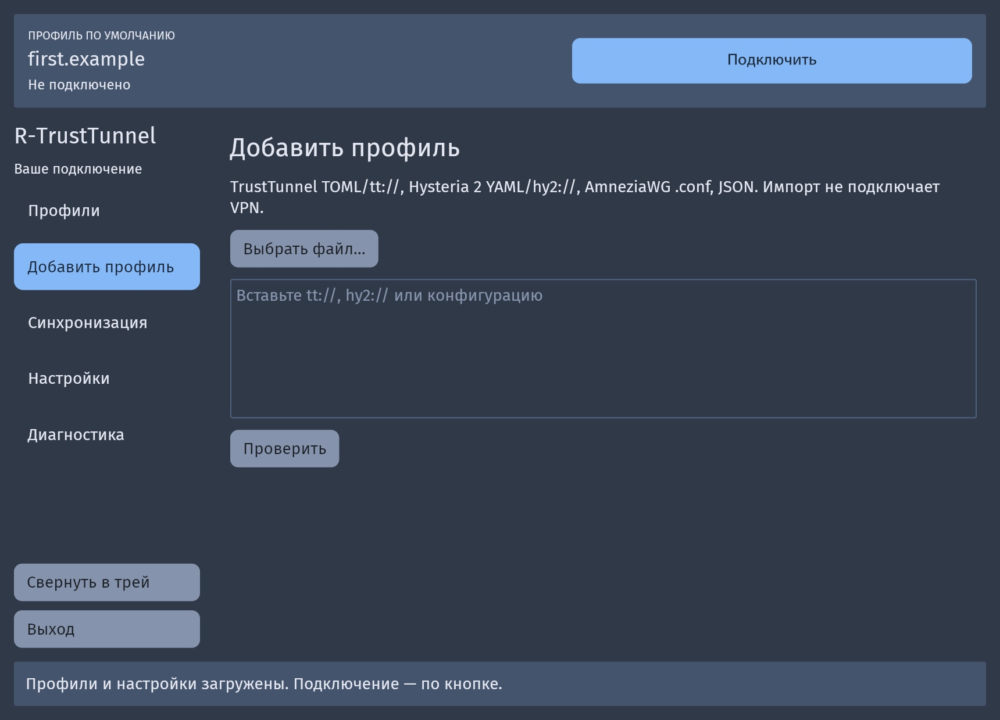
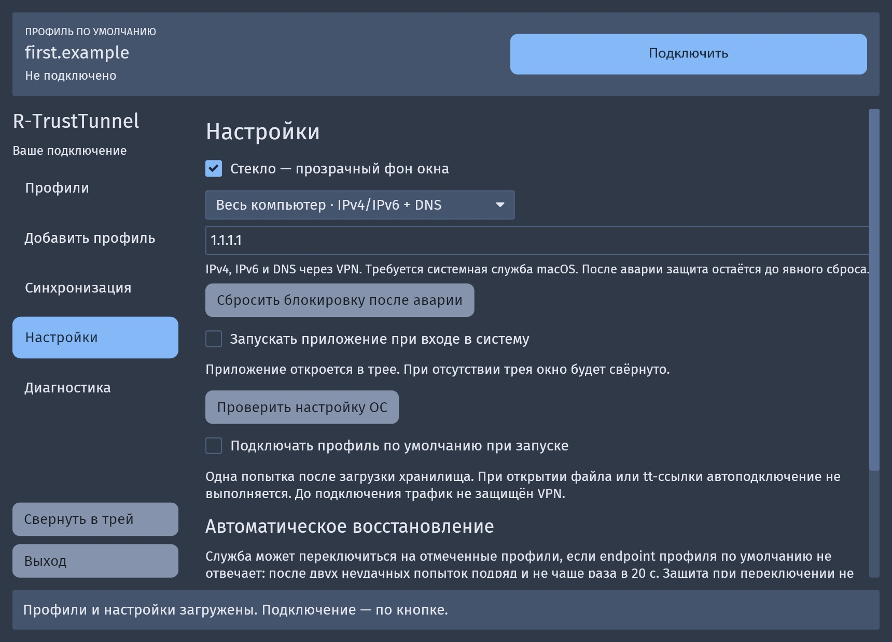
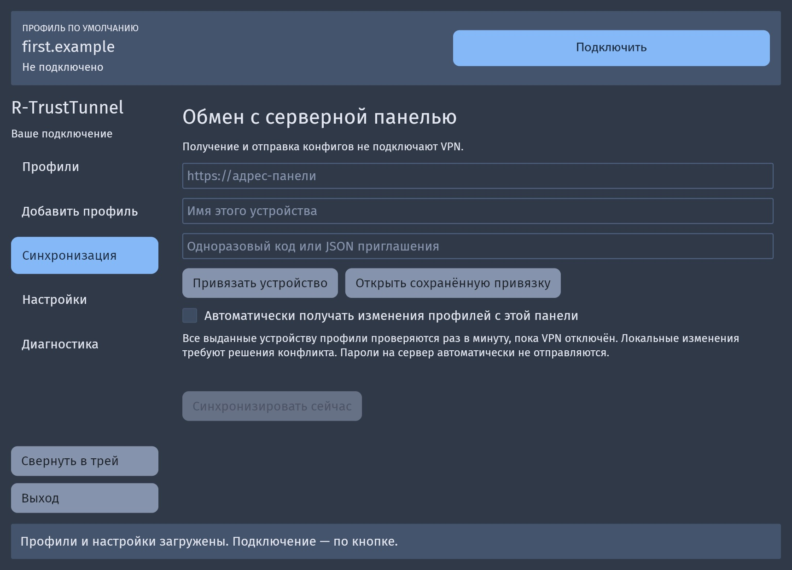
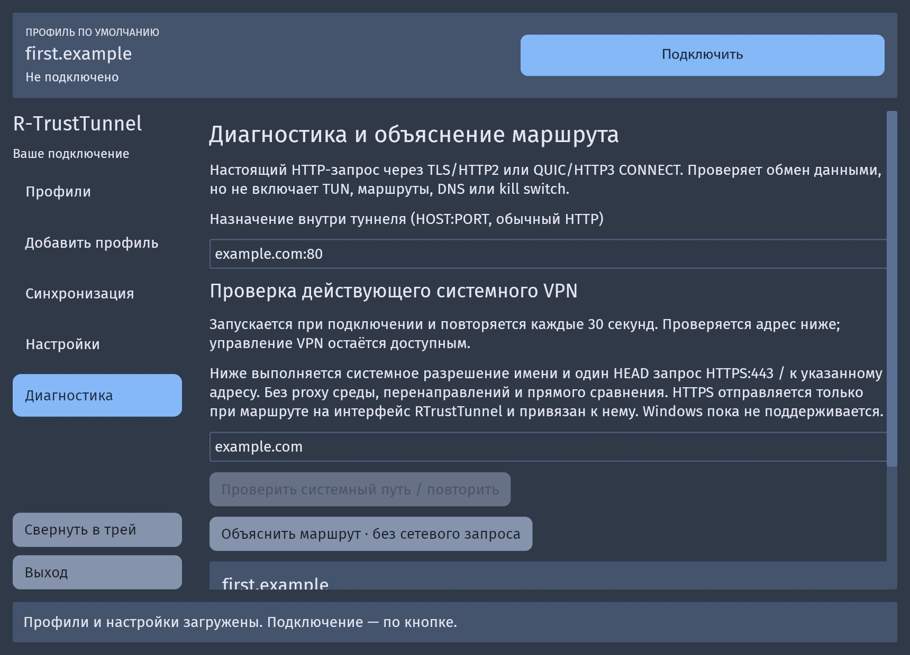
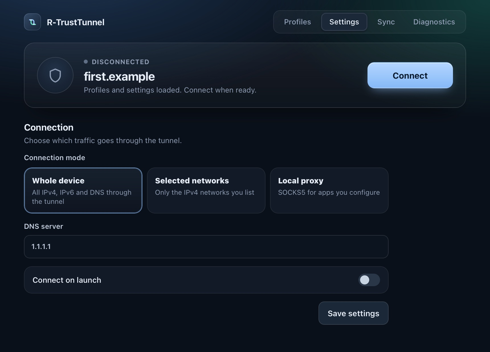
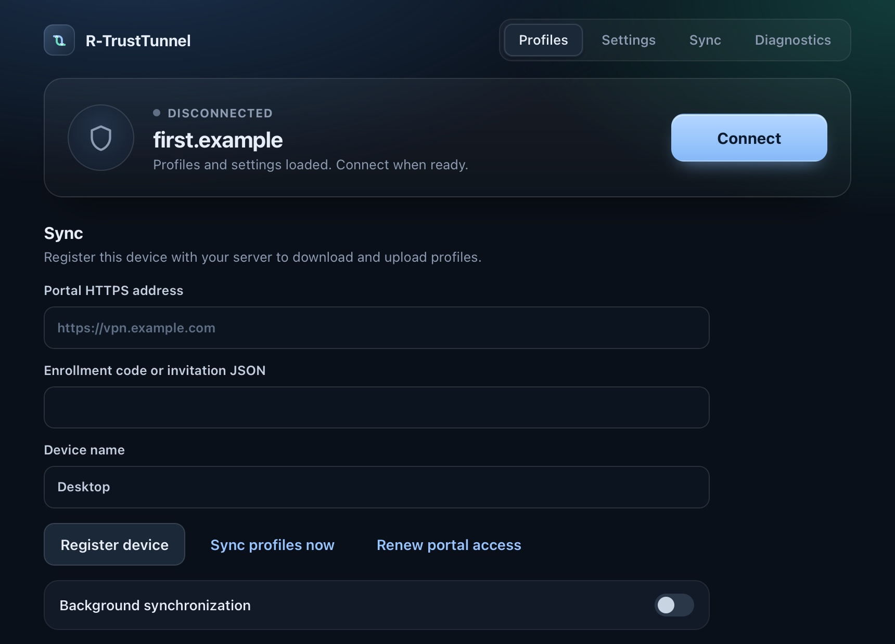
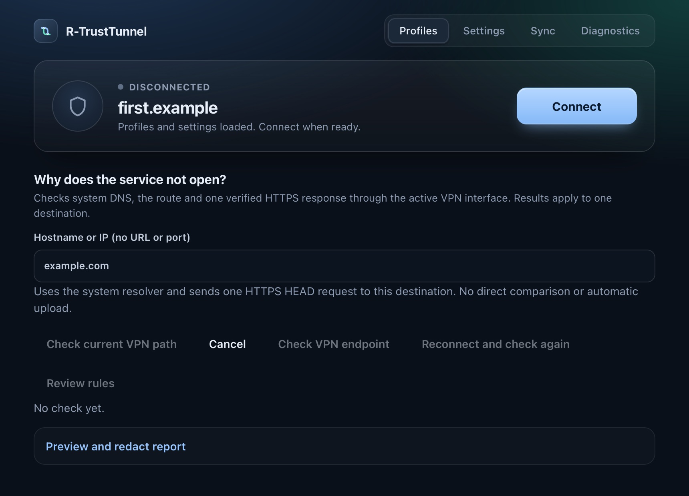

# Client screenshots / Скриншоты клиентов

The images show the desktop UI of source version **0.6.1** (main `fdb5651`,
captured on October 14, 2026). The profiles are synthetic (`first.example`,
`second.example`, `hy2.example`, documentation address `192.0.2.1`). No real server, account,
vault or VPN session appears in them, and nothing was connected while capturing.

Снимки показывают desktop-интерфейс исходников **0.6.1** (main `fdb5651`,
14 октября 2026). Профили синтетические (`first.example`, `second.example`, `hy2.example`,
документационный адрес `192.0.2.1`). Реальных серверов, учётных данных,
хранилища и VPN-сессий на снимках нет; при съёмке ничего не подключалось.

## How they were made / Как сделаны

- **Native.** The real `App::view()` of `apps/native`, rendered offscreen at 2×
  by `iced_test` with the wgpu renderer used on macOS. The app state was built
  the same way as in the unit tests, so no keyring, vault or service was touched.
  The offscreen renderer uses the Fira Sans font and has no macOS glass material,
  so the installed app looks slightly different.
- **WebView.** The real `apps/webview/ui` files in WebKit (`WKWebView`, the engine
  Tauri uses on macOS) at 2×. The Tauri bridge was replaced by a stub that
  returns synthetic profiles and settings.

- **Native** — настоящий `App::view()` из `apps/native`, отрисованный офскрин
  в 2× через `iced_test` с тем же wgpu-рендерером, что на macOS. Состояние
  собрано как в unit-тестах, поэтому Keychain, хранилище и служба не
  использовались. Шрифт Fira Sans, без стеклянного фона macOS — установленное
  приложение выглядит немного иначе.
- **WebView** — настоящие файлы `apps/webview/ui` в WebKit (`WKWebView`, движок
  Tauri на macOS) в 2×. Мост Tauri заменён заглушкой с синтетическими данными.

These are not window captures of an installed package. The installed client on
the capture Mac holds real profiles and controls a live VPN session, and a second
GUI instance shares its keychain entries, so it was not used.

Это не снимки окна установленного пакета: установленный клиент на этом Mac
содержит реальные профили и управляет активным VPN, а второй экземпляр GUI
делит с ним записи Keychain.

## Native

### Profiles / Профили

The top card connects the selected profile. The status line at the bottom
reports the vault and connection state.

Верхняя карточка подключает выбранный профиль. Строка внизу показывает
состояние хранилища и подключения.

### Add a profile / Добавить профиль

TrustTunnel TOML/`tt://`, Hysteria 2 YAML/`hy2://`, AmneziaWG `.conf` and
R-TrustTunnel JSON. The profile is checked and previewed before it is saved.
Import never connects the VPN.

### Settings / Настройки

System VPN mode («Весь компьютер · IPv4/IPv6 + DNS»), login startup, connect on
launch and opt-in automatic recovery through backup profiles.

### Sync / Синхронизация

Device enrollment and profile exchange with the TrustTunnel portal. Enrollment
and sync do not connect the VPN.

### Diagnostics / Диагностика

The in-tunnel HTTP request, the system VPN path check (runs on connect and every
30 seconds) and the offline route explanation. See
[system diagnostics](../system-diagnostics.md) and [route explain](../route-explain.md).

## WebView

| Profiles | Settings |
| --- | --- |
|  |  |
| **Sync** | **Diagnostics** |
|  |  |

**Known issue.** In WebKit the top tab bar keeps **Profiles** highlighted after
you switch tabs. The page content changes correctly, but WebKit does not
recompute the `[aria-current]` style. Chromium shows the correct tab. The
Settings, Sync and Diagnostics captures show this defect as it is.

**Известный дефект:** в WebKit после переключения вкладок подсветка остаётся на
**Profiles**, хотя содержимое меняется правильно. В Chromium подсвечивается
нужная вкладка. На снимках дефект оставлен как есть.

## Scope / Границы

These screenshots show the interface. They are not evidence of network
acceptance; see the [release records](../releases/). They are macOS renders and
must not be presented as Linux or Windows captures. The Android app blocks
screenshots with `FLAG_SECURE`, and that protection was not disabled for
documentation. The iOS preview has no screenshots here.

Снимки показывают интерфейс и не доказывают сетевую приёмку. Это рендер на
macOS, не Linux и не Windows. Android блокирует скриншоты через `FLAG_SECURE`;
защиту ради документации не отключали. Снимков iOS здесь нет.
