# Client screenshots / Скриншоты клиентов

The images show the desktop UI variant 3 of source version **0.7.0** (main
`8512a61`, captured on October 29, 2026) in Russian. The UI code is the same
as in the v0.7.0 tag (`232fd7b`). The profiles are synthetic
(`first.example`, `second.example`, `hy2.example`, documentation address
`192.0.2.1`). No real server, account, vault or VPN session appears in them,
and nothing was connected while capturing.

Снимки показывают desktop-интерфейс варианта 3 исходников **0.7.0** (main
`8512a61`, 29 октября 2026); код интерфейса совпадает с тегом v0.7.0
(`232fd7b`). Профили синтетические (`first.example`,
`second.example`, `hy2.example`, документационный адрес `192.0.2.1`). Реальных
серверов, учётных данных, хранилища и VPN-сессий на снимках нет; при съёмке
ничего не подключалось.

## How they were made / Как сделаны

- **Native.** The real `App::view()` of `apps/native` at 1180×780, rendered
  offscreen at 2× by `iced_test` with the wgpu renderer used on macOS. The app
  state was built the same way as in the unit tests, so no keyring, vault or
  service was touched. The offscreen renderer uses the Fira Sans font and has no
  macOS glass material, so the installed app looks slightly different.
- **WebView.** The real `apps/webview/ui` files in an on-screen `WKWebView`
  window (the engine Tauri uses on macOS) at 1180×780, 2×. The Tauri bridge was
  replaced by a stub that returns the JSON of a real `rtrust_desktop::Controller`
  view built from the same synthetic profiles.

- **Native** — настоящий `App::view()` из `apps/native` в окне 1180×780,
  отрисованный офскрин в 2× через `iced_test` с тем же wgpu-рендерером, что на
  macOS. Состояние собрано как в unit-тестах, поэтому Keychain, хранилище и
  служба не использовались. Шрифт Fira Sans, без стеклянного фона macOS —
  установленное приложение выглядит немного иначе.
- **WebView** — настоящие файлы `apps/webview/ui` в видимом окне `WKWebView`
  (движок Tauri на macOS) 1180×780 в 2×. Мост Tauri заменён заглушкой, которая
  возвращает JSON настоящего `rtrust_desktop::Controller` с теми же
  синтетическими профилями.

These are not window captures of an installed package: the installed client on
the capture Mac holds real profiles and controls a live VPN session. Both UIs are
shown disconnected, so the Checks rows read "no data"; a connected session is
not staged.

Это не снимки окна установленного пакета: установленный клиент на этом Mac
содержит реальные профили и управляет активным VPN. Оба интерфейса сняты без
подключения, поэтому строки проверок показывают «нет данных».

## Native

| Home | Home, light theme |
| --- | --- |
| 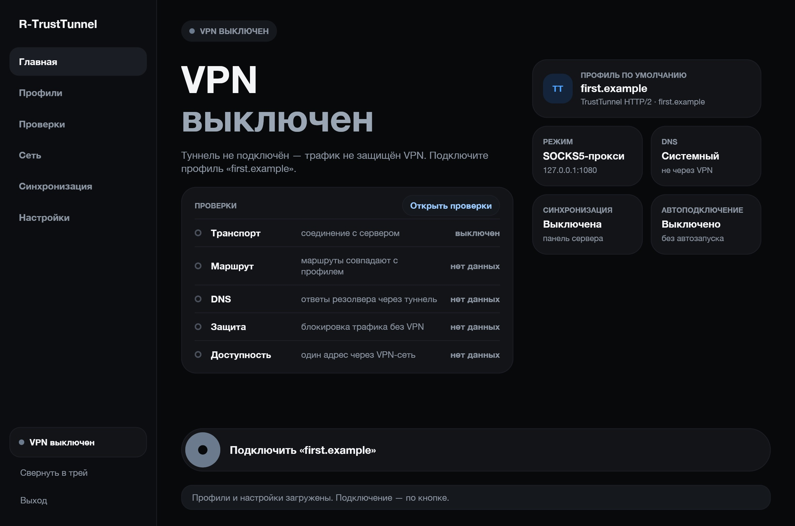 | 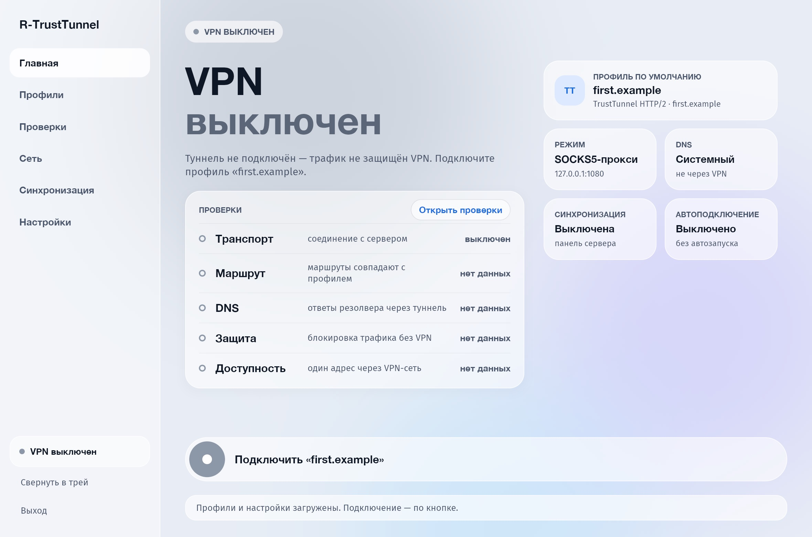 |
| **Profiles** | **New profile** |
| 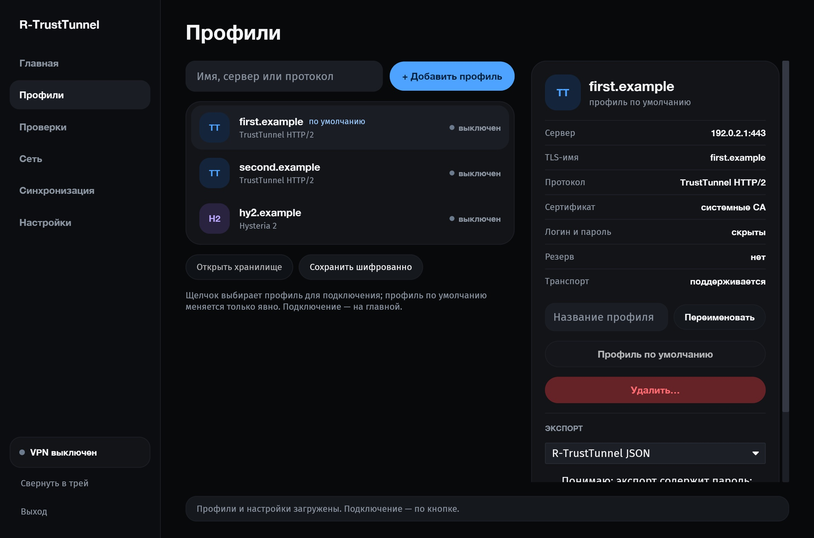 | 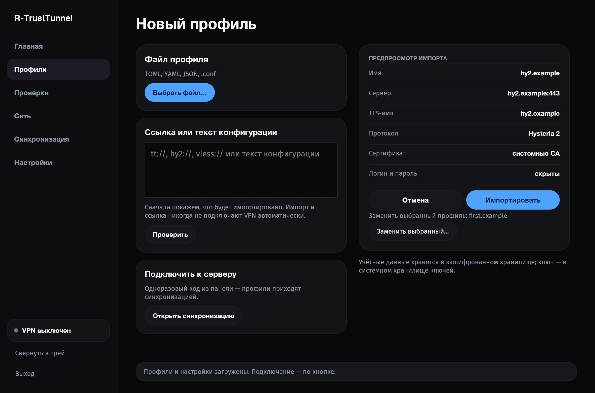 |
| **Checks** | **Network** |
| 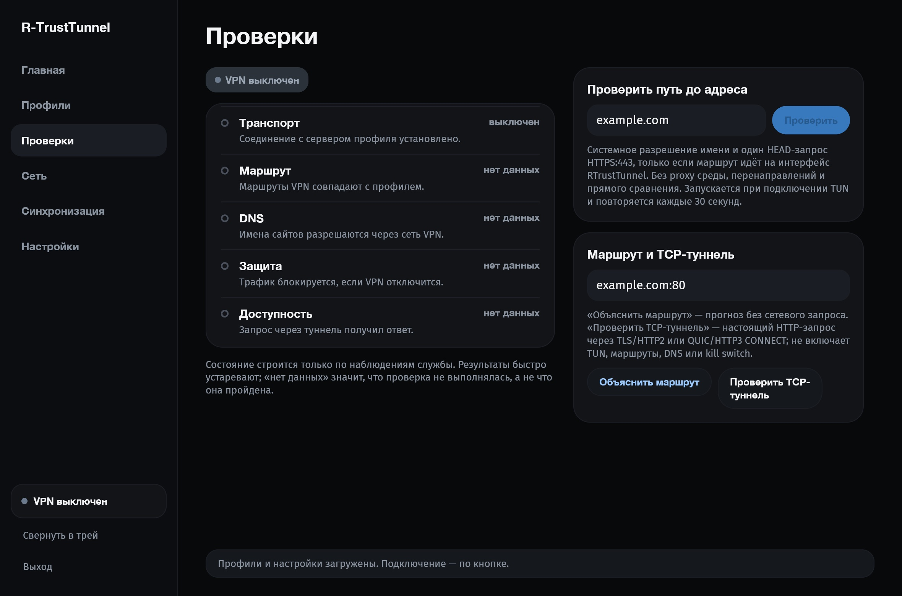 | 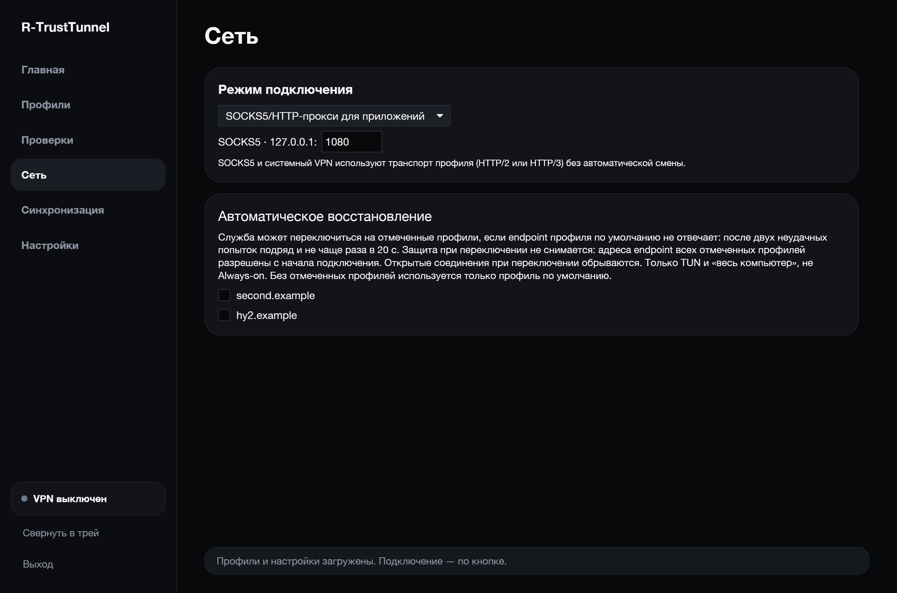 |
| **Sync** | **Settings** |
| 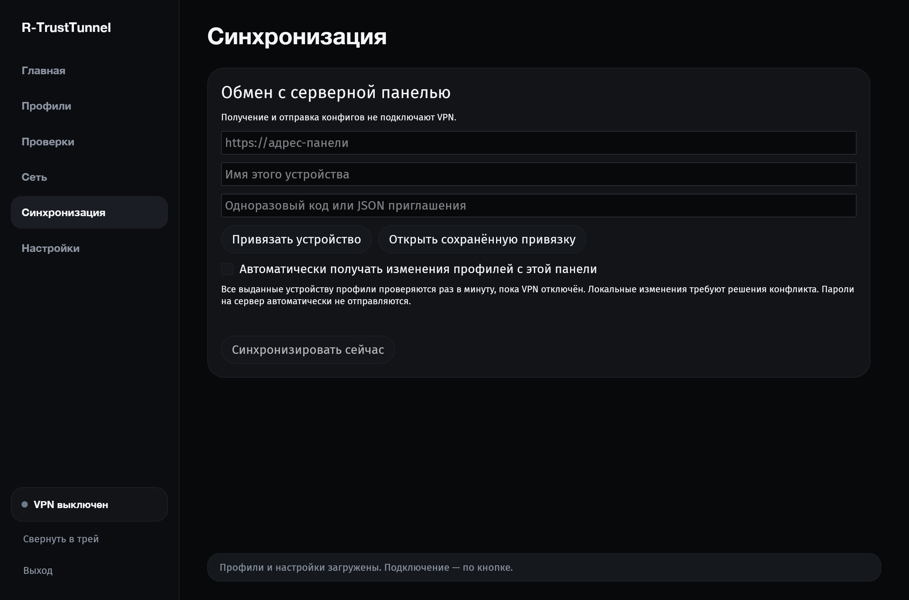 | 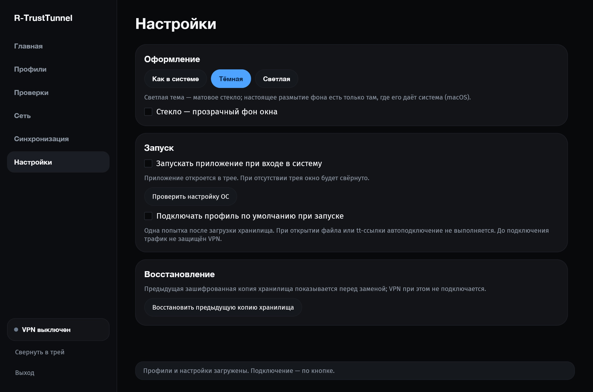 |

- **Home / Главная:** connection state, the five checks, the default profile,
  mode, DNS, sync and autoconnect tiles, and the connect bar.
- **New profile / Новый профиль:** TrustTunnel TOML/`tt://`, Hysteria 2
  YAML/`hy2://`, AmneziaWG `.conf`, `vless://` and R-TrustTunnel JSON. The
  profile is previewed before it is saved; import never connects the VPN.
- **Checks / Проверки:** transport, route, DNS, guard and reachability, the
  system-path check and the offline route explanation. See
  [VPN observations](../vpn-observations.md),
  [system diagnostics](../system-diagnostics.md) and
  [route explain](../route-explain.md).

## WebView

| Home | Home, light theme |
| --- | --- |
| 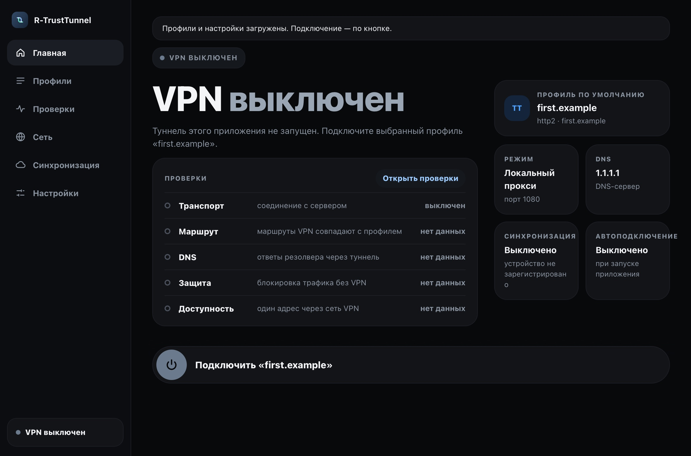 | 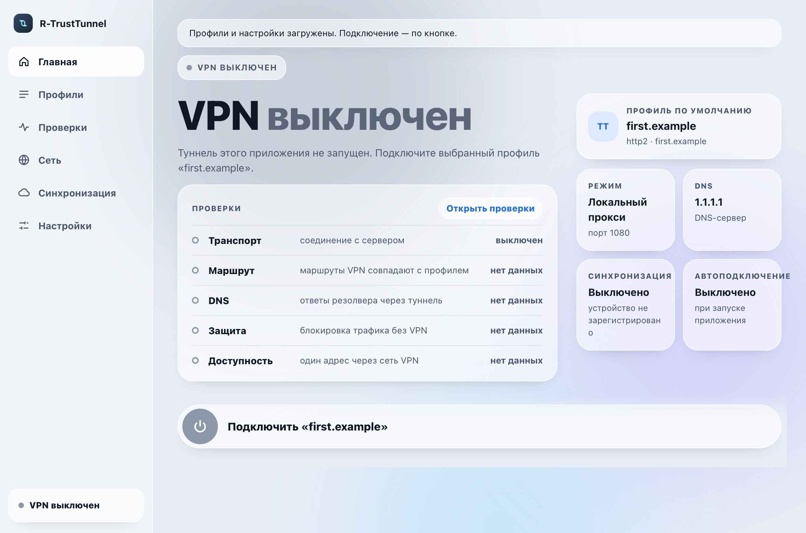 |
| **Profiles** | **Checks** |
| 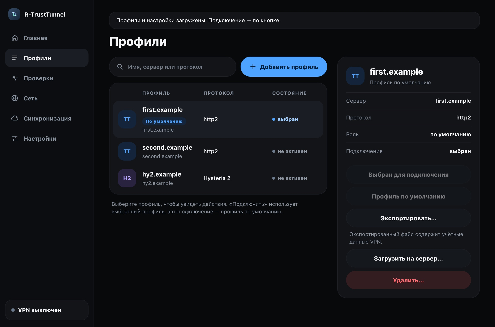 | 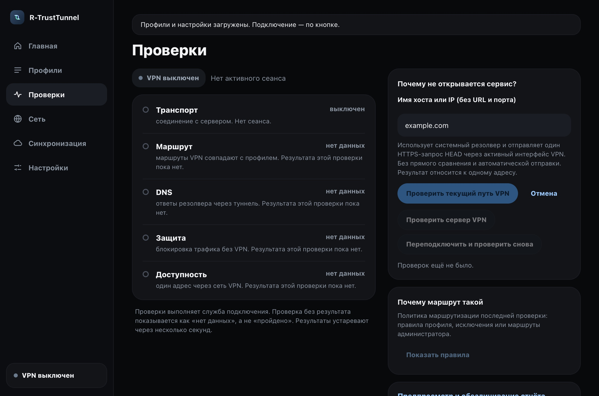 |
| **Network** | **Sync** |
| 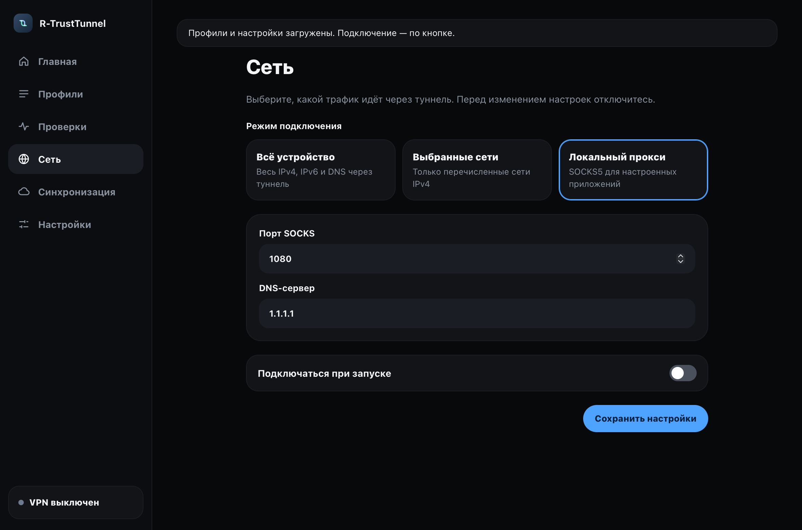 | 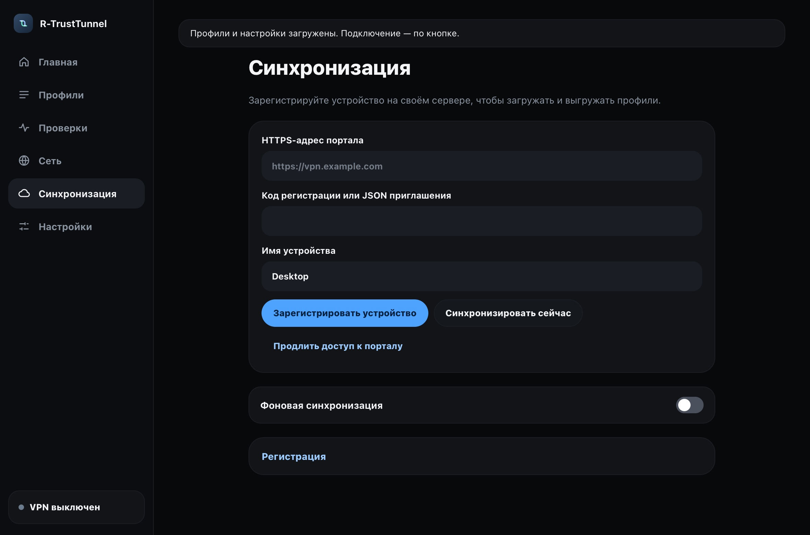 |
| **Settings** | |
| 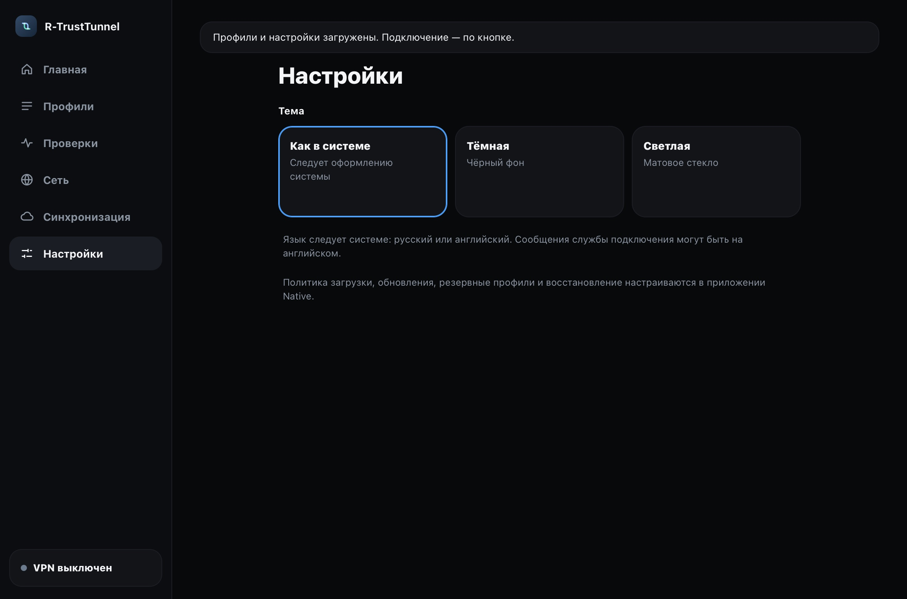 | |

## Scope / Границы

These screenshots show the interface. They are not evidence of network
acceptance; see the [release records](../releases/). They are macOS renders and
must not be presented as Linux or Windows captures. The Android app blocks
screenshots with `FLAG_SECURE`, and that protection was not disabled for
documentation. The iOS preview has no screenshots here.

Снимки показывают интерфейс и не доказывают сетевую приёмку. Это рендер на
macOS, не Linux и не Windows. Android блокирует скриншоты через `FLAG_SECURE`;
защиту ради документации не отключали. Снимков iOS здесь нет.
